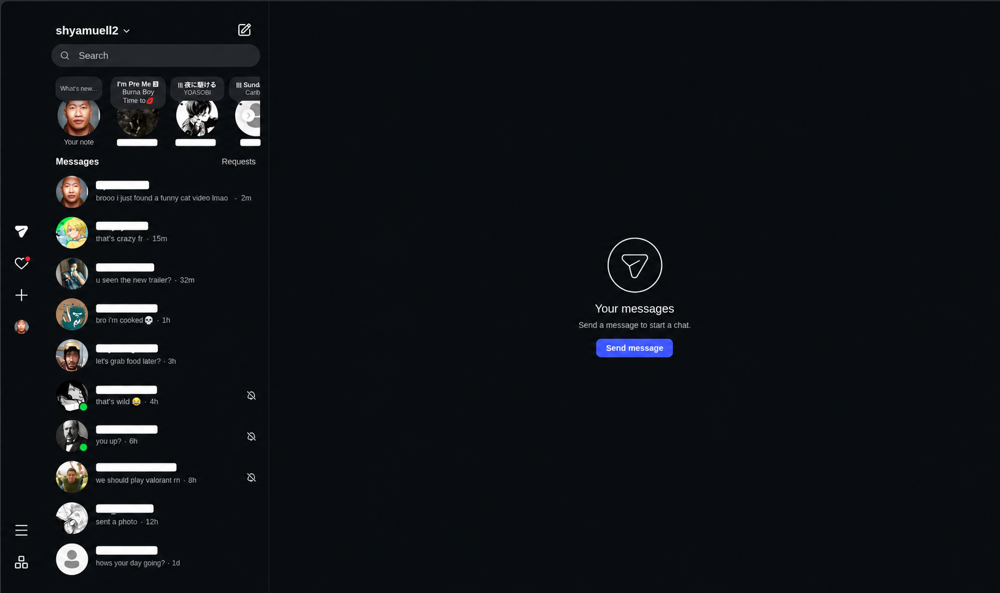

# Distraction Blocker

A single userscript that keeps social sites from pulling you into endless feeds.

- **Instagram:** DMs only. Blocks Reels, posts (`/p/`) and Explore. Opening `instagram.com` drops you into `/direct/inbox/`. A reel or post a friend sends still shows in the chat, but clicking it does nothing instead of opening the Reels feed.
- **YouTube:** Shorts open as normal videos. Any `/shorts/ID` link is redirected to `/watch?v=ID`, and Shorts shelves and menu entries are hidden.

Works on desktop (Firefox, Chrome, Brave, Edge and other Chromium browsers) and on Android via Firefox.

## Screenshot

## Install

1. Install a userscript manager:
   - [Violentmonkey](https://violentmonkey.github.io/) (recommended)
   - [Tampermonkey](https://www.tampermonkey.net/)
2. Click the install link:

   **[Install Distraction Blocker](https://raw.githubusercontent.com/sam4duh/userscripts/main/distraction-blocker.user.js)**

3. Confirm the install prompt. Updates arrive automatically when `@version` is bumped.

### Chrome / Chromium notes

Recent Chrome versions require allowing user scripts. Open `chrome://extensions`, then either enable **Developer mode** or turn on **Allow User Scripts** in the extension's details. If the script silently does nothing, this is almost always why.

### Android

Chrome on Android does not support userscript extensions. Use **Firefox for Android**, install Violentmonkey, then add the script.

## How it works

For each site the script:

1. Redirects direct loads of blocked pages (Instagram: `/`, `/reels`, `/reel`, `/p`, `/explore`; YouTube: `/shorts/...`).
2. Wraps `history.pushState` / `replaceState`, since both sites are single-page apps and navigate without reloading.
3. Intercepts clicks on links to blocked pages.
4. Hides related menu entries and shelves with CSS.

## Limitations

- Both sites change their markup often. The redirect logic works off URLs and should keep working, but the CSS hiding rules may break. If a Shorts shelf or menu entry slips through, open an issue with the element's tag name (right-click, Inspect).
- Instagram's home route (`/`) is blocked, so the logo link goes to the inbox instead.
- Not tested against every browser or userscript manager.

## License

[MIT](LICENSE)
